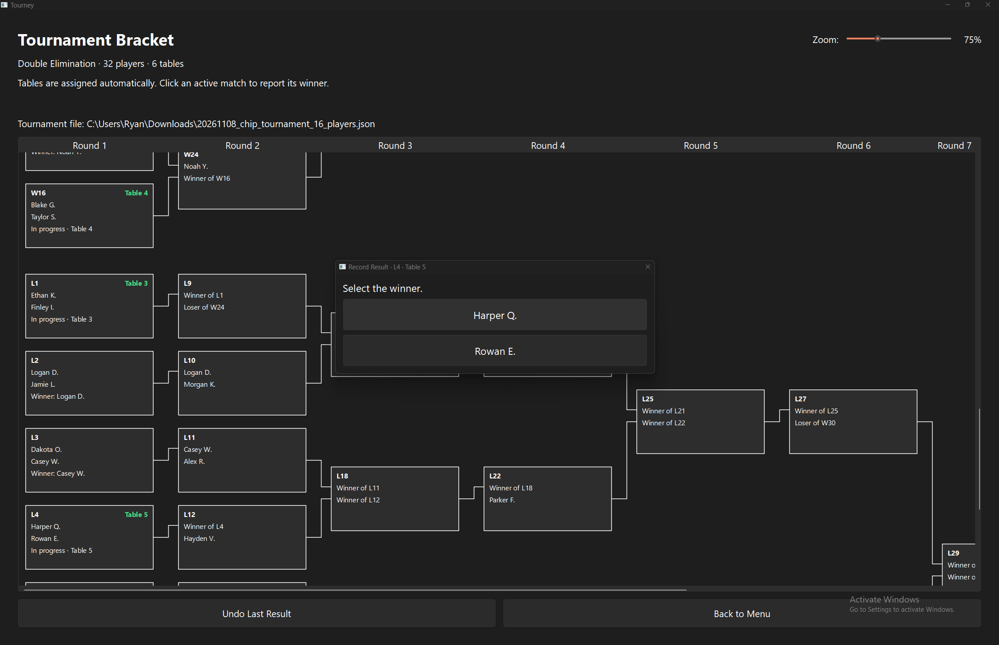
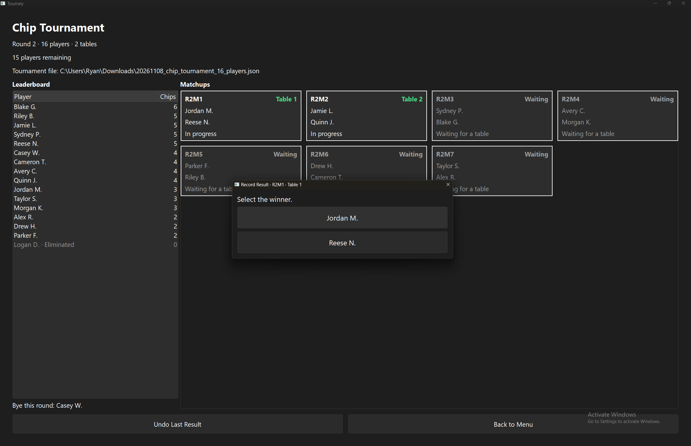

# Tourney

Run a tournament without keeping a paper bracket or working out who plays next.
Tourney tracks players, assigns matches to tables, records winners, and saves
your progress as you go. It supports **2–32 players** in single elimination,
double elimination, or a chip tournament.

## Open the app

Download **Tourney.exe** from the [Releases page](https://github.com/rumhamryan/tourney/releases)
and double-click it. The portable app runs on **Windows 11 x64**. You do not
need to install Python or stay connected to the internet to use it.

Keep the executable wherever convenient. Your tournament saves are separate
files, so you can replace the executable when updating without losing an event.
The app is unsigned, so Windows may show a warning when you download or open it.

## Choose a tournament format

| Format | How players are eliminated | What to expect |
| --- | --- | --- |
| **Single Elimination** | One loss eliminates a player. | Winners advance through one bracket until the final decides the champion. |
| **Double Elimination** | Two losses eliminate a player. | A first loss moves a player into the losers' bracket. The winners' and losers' finalists meet in the grand final. |
| **Chip Tournament** | Each loss costs one chip. A player with no chips is out. | Players are randomly paired each round. The last player with chips wins. |

## Set up your event

1. Choose a format from the main menu.
2. Set **Number of tables** to the number you have available. Tourney assigns
   matches to those tables automatically.
3. Enter each player's name and click **Add**, or use **Import Players…** to
   load a list. You need **2–32 players**. For a chip tournament, also enter
   each player's starting chip count, from **1 to 10**.
4. Review the list and click **Start**. Choose where to save the tournament's
   `.json` file, then begin play.

The suggested filename includes the date, format, and player count, such as
`20261108_single_elimination_32_players.json`. Keep this file somewhere you
can find again; Tourney saves results to it throughout the event.

To remove players before starting, select their names and click **Remove
Selected**. In chip setup, click a player to edit their name or starting chips,
then click **Update Player**. Add any name still in the entry field before
clicking Start.

### Import players from a TXT or CSV file

Click **Import Players…** on any setup page and choose a `.txt` or `.csv` file.
A successful import **replaces the current player list**, so import first and
make any final adjustments afterward.

For a simple list, put one name on each line:

```text
Alice
Bob
Charlie
```

This works for all three tournament formats. For chip tournaments, names
imported without a chip count start with **4 chips each**.

To specify starting chips, put a comma after each name, followed by the count:

```csv
name,chips
Alice,6
Bob,4
Charlie,4
Derek,3
```

The header is optional. Use whole-number chip counts from **1 to 10**; leave
the count blank to use **4**. Save the file as **UTF-8** with either a `.txt`
or `.csv` extension.

The import result reports how many players were added and which lines were
skipped. Duplicate names, blank names, invalid chip counts, extra columns, and
players beyond the 32-player limit are skipped while usable players are imported.
Review the result and the player list before starting.

An unreadable file, unsupported encoding, broken CSV quoting, or a file with no
usable players leaves your existing list unchanged.

## Run an elimination bracket

Look for matches showing **In progress** and a green table number. Send those
players to their assigned tables. When a match finishes, click its card and
select the winner's name in the result dialog. Tourney advances the winner,
updates the bracket, and assigns available matches to free tables.



## Run a chip tournament

Click an active matchup and select the winner. The loser loses **one chip**;
the winner keeps their current chips. A player who reaches zero is marked
**Eliminated**. After every match in the round finishes, Tourney creates the
next round's pairings automatically.



## Correct a result

If you picked the wrong winner, click **Undo Last Result** or press **Ctrl+Z**.
Review the confirmation: it shows which table assignment will be restored.
Stop any affected play before confirming, since undo can bring an earlier
match back onto a table.

## Stop and resume later

Every result and undo is saved automatically to the tournament file shown on
screen. You can close Tourney and come back later.

To resume, open Tourney, choose **Load Tournament** from the main menu, and
select the event's `.json` file. Your bracket or chip round, table assignments,
and results return exactly as saved. Use Load Tournament to continue an event;
choosing a format and clicking Start creates a new one.

To save under another name or move the active save to a different folder,
press **Ctrl+Shift+S** on the tournament screen. Choose the new file; Tourney
will use that location for future automatic saves. Keep the `.json` file if
you move the event to another computer.

## Useful keyboard shortcuts

| Action | Shortcut on Windows |
| --- | --- |
| Add a player in elimination setup | Enter in the name field |
| Enter a chip player | Enter in the name field moves to chips; Enter in the chip field adds the player |
| Remove selected players in setup | Delete while the player list has focus |
| Undo the last result | Ctrl+Z |
| Save the tournament under another name | Ctrl+Shift+S |
| Load a tournament from the main menu | Ctrl+O |
| Leave a winner dialog without recording a result | Escape |
| Move between controls | Tab / Shift+Tab |
